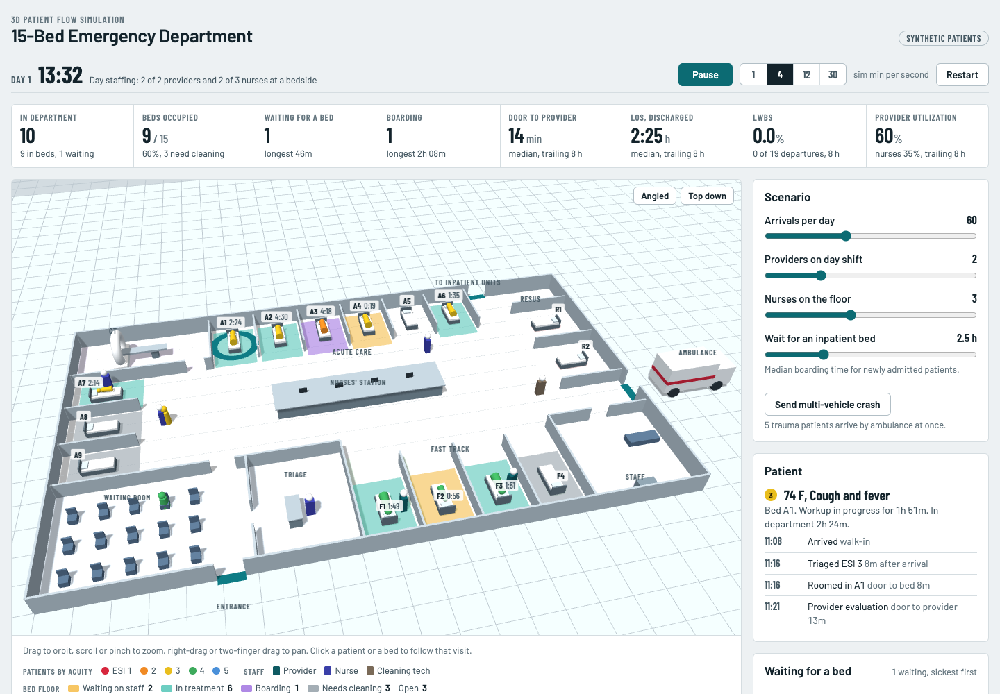
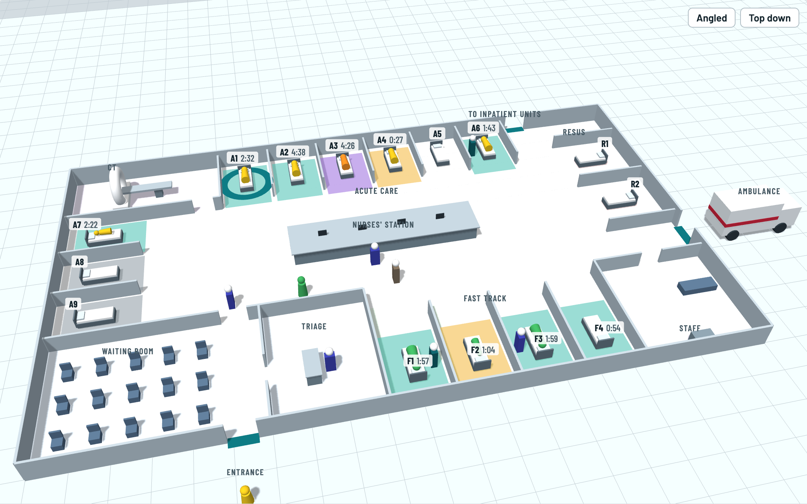
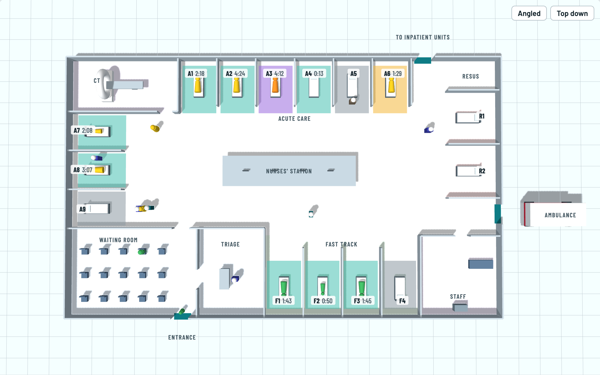
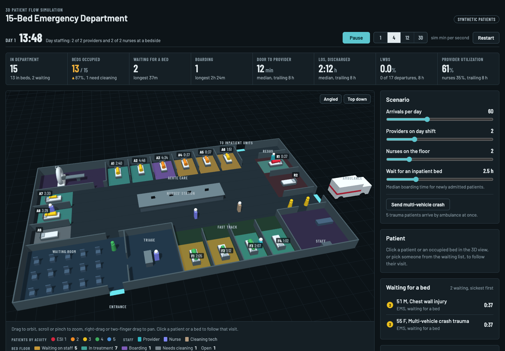
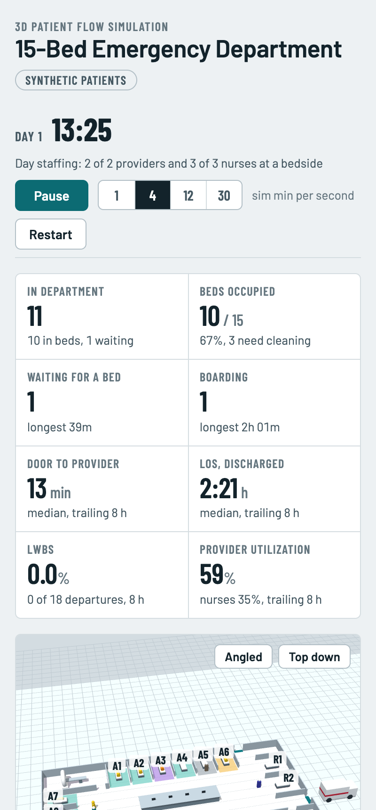
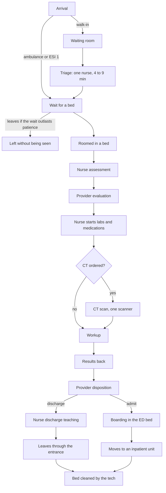

# 15-Bed Emergency Department: 3D Patient Flow Simulation

An interactive 3D model of a small emergency department. Patients arrive, get triaged, wait, take a bed, see a nurse and a provider, go to CT, and leave by discharge or admission, while staff walk the floor to reach them. You can orbit the floor, change staffing and demand while it runs, and follow any single visit from door to disposition.

It is one HTML file with no build step.



> **All patients and timings are generated.** The parameters are illustrative and are not calibrated to any real hospital. This is a teaching and exploration tool, not a planning or clinical tool.

## Contents

- [Quick start](#quick-start)
- [What you can do with it](#what-you-can-do-with-it)
- [Screenshots](#screenshots)
- [How the model works](#how-the-model-works)
- [Parameters](#parameters)
- [Metrics](#metrics)
- [Running the engine without a browser](#running-the-engine-without-a-browser)
- [Project layout](#project-layout)
- [Changing the model](#changing-the-model)
- [Limitations](#limitations)
- [Technical notes](#technical-notes)

## Quick start

```bash
git clone https://github.com/Tyler-Scales/ed-3d-simulation.git
cd ed-3d-simulation
open index.html        # macOS; on Windows or Linux, open the file in a browser
```

Opening the file directly works. If you would rather serve it:

```bash
python3 -m http.server 8000
# then visit http://localhost:8000
```

The page loads three.js and two fonts from public CDNs, so the first load needs an internet connection. It needs a browser with WebGL. Without WebGL the 3D view is replaced by a notice and the numbers, charts and lists keep running.

## What you can do with it

| Control | What it does |
| --- | --- |
| Drag on the floor | Orbit the camera |
| Scroll or pinch | Zoom |
| Right-drag or two-finger drag | Pan |
| **Angled** / **Top down** | Jump to a preset camera |
| Click a patient or an occupied bed | Follow that visit: status, bed, and a timestamped timeline |
| **Pause** / **Play** | Stop and resume the clock |
| Speed: 1, 4, 12, 30 | Simulated minutes per real second |
| **Restart** | New random day with the current settings |
| Arrivals per day | 30 to 110 patients (default 60) |
| Providers on day shift | 1 to 5 (default 2); nights run at half, rounded up |
| Nurses on the floor | 1 to 6 (default 3) |
| Wait for an inpatient bed | Median boarding time, 0.5 to 8 hours (default 2.5) |
| **Send multi-vehicle crash** | Five trauma patients arrive by ambulance at once |

Every lever takes effect immediately, so you can watch a bottleneck form and clear. Two things worth trying:

1. Drop to one provider and one nurse at midday. Bed floors turn amber as patients wait on staff, door-to-provider time climbs past an hour, and the waiting room fills.
2. Raise the inpatient bed wait to 6 hours. Purple boarding beds accumulate in acute care and new arrivals overflow into resus and fast track.

### Reading the floor

| What you see | Meaning |
| --- | --- |
| Round figure, red / orange / yellow / green / blue | Patient, by acuity (ESI 1 to 5). Children are drawn smaller. |
| Square figure with a white head | Staff: provider (teal), nurse (indigo), cleaning tech (brown) |
| Amber bed floor | Patient is waiting on a nurse, a provider or the CT scanner |
| Teal bed floor | In treatment: someone is at the bedside or the workup is running |
| Purple bed floor | Admitted and boarding until an inpatient bed opens |
| Grey bed floor | Empty but not yet cleaned |
| Label over a bed | Bed name and time since that patient arrived |

## Screenshots

| | |
| --- | --- |
|  |  |
| Angled view. The ring marks the selected patient. | Top-down view of the same floor. |
|  |  |
| Dark theme, minutes after a five-patient crash with only two nurses. | Phone width. |

## How the model works

The simulation advances in one-minute steps. Each step it generates arrivals, finishes any timed activity that is due, and then hands out the scarce things in order: the triage nurse, beds, the CT scanner, providers, nurses and the cleaning tech.

### Floor plan

- **Resuscitation:** 2 bays (R1, R2), next to the ambulance entrance
- **Acute care:** 9 beds (A1 to A9), along the north and west walls
- **Fast track:** 4 beds (F1 to F4), next to triage
- One triage room, one CT scanner, a 15-seat waiting room, a central nurses' station, a staff room, an ambulance entrance and an exit to the inpatient units

### Patient pathway



ESI 1 patients skip the nurse assessment and go straight to the top of the provider queue.

### Rules

**Arrivals.** Poisson arrivals with a rate that follows a typical ED day: lowest between 03:00 and 06:00, climbing through the morning, and highest from late morning into the evening. About 15% arrive by ambulance. 18% of patients are children.

**Acuity.** Each patient gets an Emergency Severity Index level from 1 (most urgent) to 5. Ambulance arrivals skew sicker than walk-ins.

**Bed assignment.** Waiting patients are placed sickest first, then by arrival time.

| Acuity | First choice | Overflow |
| --- | --- | --- |
| ESI 1 | Resuscitation | Acute care, then fast track |
| ESI 2 | Acute care | Resuscitation, if both bays are free or the wait has passed 45 min |
| ESI 3 | Acute care | Fast track, after 45 min and with at least 2 fast track beds free |
| ESI 4 to 5 | Fast track | Acute care, after 60 min and with at least 3 acute beds free |

**Staff.** A step that needs a person does not start until that person is free, and the patient waits in bed.

- *Providers* do the evaluation and the disposition. Both share one queue: ESI 1 first, ESI 2 with a 20-minute head start, otherwise first come first served. From 23:00 to 07:00 only half the providers are on duty, and the rest go to the staff room.
- *Nurses* do the first assessment, start labs and medications, and do discharge teaching. ESI 1 first, otherwise first come first served.
- *One triage nurse* stays in the triage room.
- *One cleaning tech* cleans beds in the order they were vacated. A bed cannot be reused until it is cleaned.

**CT.** A share of patients need a CT during their workup. There is one scanner, the sickest waiting patient goes first, and results are not back until at least 20 minutes after the scan.

**Admission and boarding.** Admitted patients stay in their ED bed for a boarding time drawn around the slider value. ESI 1 patients board for less time, since they go to intensive care.

**Leaving without being seen.** ESI 3 to 5 patients each have a patience limit. If they are still in the waiting room when it runs out, they leave.

**Movement.** Walking paths follow the corridor around the nurses' station. Walking is sped up so it stays visible at high speed, and it does not add to any visit time.

## Parameters

All of these live at the top of the engine in `index.html`. Timed activities are drawn from a lognormal distribution around the median shown, clamped to between 0.3 and 4 times the median.

### By acuity

| | ESI 1 | ESI 2 | ESI 3 | ESI 4 | ESI 5 |
| --- | --- | --- | --- | --- | --- |
| Share of walk-ins | 0.3% | 15% | 46% | 31% | 7.7% |
| Share of ambulance arrivals | 5% | 42% | 43% | 9% | 1% |
| Admitted (halved for children) | 85% | 45% | 22% | 3% | 0.5% |
| Provider evaluation, median min | 30 | 22 | 17 | 11 | 8 |
| Workup, median min (x0.8 for children) | 120 | 140 | 110 | 35 | 12 |
| Needs CT | 70% | 40% | 30% | 4% | 0% |
| Patience before leaving, median min | never leaves | never leaves | 240 | 170 | 130 |

### Other timings

| Activity | Median | Needs |
| --- | --- | --- |
| Triage | 4 to 9 min, uniform | Triage nurse |
| Nurse assessment | 6 min | Nurse |
| Labs and medications | 8 min (4 for ESI 5) | Nurse |
| CT scan | 18 min | Scanner |
| Disposition | 10 min | Provider |
| Discharge teaching | 12 min | Nurse |
| Boarding | Slider value (x0.6 for ESI 1) | Nothing; the bed stays occupied |
| Bed cleaning | 10 min | Cleaning tech |

## Metrics

| Metric | Definition |
| --- | --- |
| In department | Everyone not yet departed: in beds plus waiting |
| Beds occupied | Beds with a patient, out of 15 |
| Waiting for a bed | Patients without a bed, including those in triage, and the longest current wait |
| Boarding | Admitted patients still in an ED bed, and the longest current boarding time |
| Door to provider | Median minutes from arrival to the start of the provider evaluation, trailing 8 hours |
| LOS, discharged | Median length of stay for discharged patients, trailing 8 hours |
| LWBS | Share of departures in the trailing 8 hours that left without being seen |
| Provider utilization | Share of on-duty provider time spent at a bedside, trailing 8 hours. Nurse utilization is shown beneath it. |

The census chart plots patients in beds, boarding and waiting over the last 24 simulated hours, sampled every 5 minutes.

## Running the engine without a browser

The engine has no dependency on the page, so you can run many simulated days in a second and compare scenarios. This needs Node.js and nothing else.

```bash
node scripts/run-headless.js --days 5
```

Output, with the table borders trimmed:

```text
Parameters: {"perDay":60,"providers":2,"nurses":3,"boardMed":150} seed 15029
day  arrivals  departures  LWBS %  admit %  door-to-provider (min)  LOS discharged (min)  LOS admitted (min)  CT scans
1    62        67          0       20.9     21                      163                   431                 12
2    63        56          0       14.3     15                      149                   448                 16
3    63        62          1.6     14.5     28                      197                   299                 14
4    59        71          0       18.3     26                      156                   399                 10
5    59        61          1.6     18       21                      161                   336                 17
Average beds occupied: 8.4 of 15 | peak beds: 15 | peak waiting: 6
```

With one provider and one nurse, a three-day run gives median door-to-provider times over 100 minutes and LWBS between 5% and 21%:

```bash
node scripts/run-headless.js --days 3 --providers 1 --nurses 1
```

| Option | Default | Meaning |
| --- | --- | --- |
| `--days` | 7 | Simulated days to report, after one warm-up day |
| `--arrivals` | 60 | Arrivals per day |
| `--providers` | 2 | Providers on day shift |
| `--nurses` | 3 | Nurses on the floor |
| `--board` | 150 | Median boarding time in minutes |
| `--seed` | 15029 | Random seed; the same seed and options always give the same run |

## Project layout

```text
index.html                  The whole application
scripts/run-headless.js     Runs the engine in Node and prints daily results
docs/screenshots/           Images used in this README
```

`index.html` has three parts:

1. **Styles and markup** for the page, with a light and a dark theme that follow the system setting.
2. **`<script id="engine">`**: the simulation. It exposes `EDSim.create`, `EDSim.step`, `EDSim.metrics` and `EDSim.surge`, keeps all state in one plain object, and uses a seeded random number generator so runs are repeatable.
3. **The view script**: the floor plan and walking graph, the three.js scene, the figures that move between locations, and the side panels and chart.

## Changing the model

- **Timings, acuity mix, admission rates, CT rates, patience:** the constant tables at the top of the engine (`ESI_WALK`, `ESI_EMS`, `ADMIT`, `EVAL_MED`, `WORK_MED`, `CT_P`, `PATIENCE`).
- **The hourly arrival curve:** `HOURLY`, 24 relative weights starting at midnight.
- **Bed routing:** `zonePrefs`.
- **Number and type of beds:** `BEDS` in the engine, and the matching positions in the `BED` table in the view script. Each bed needs a position and the direction its head faces.
- **Default staffing and demand:** the defaults in `EDSim.create`, and the `value` attributes on the sliders.
- **Walls, rooms and furniture:** `initScene` in the view script. Coordinates are metres, with x running west to east and z running north to south.
- **Walking routes:** the graph built next to the `BED` table. Add a node for any new destination and connect it to the corridor.

After changing the engine, run `node scripts/run-headless.js` to confirm the numbers still look reasonable before opening the page.

## Limitations

- The parameters are plausible defaults, not fitted to data. Do not read the outputs as predictions for a real department.
- Nurses are modelled as a pool that performs tasks. There are no nurse-to-patient ratios or assignments.
- Staffing is fixed apart from the overnight provider reduction. There are no breaks, shift handovers or staggered shifts.
- There is one generic "provider" role, with no split between physicians and advanced practice providers, and no consultants.
- Labs, radiology reads and pharmacy are folded into a single workup time. Only CT is modelled as a shared resource.
- There are no hallway beds, no separate pediatric or behavioral health areas, no deaths, transfers or patients leaving against medical advice.
- Changing the inpatient bed wait affects patients admitted after the change, not those already boarding.
- Walking takes no simulated time.

## Technical notes

- [three.js](https://threejs.org/) r128 and its `OrbitControls`, loaded from cdnjs and jsDelivr. No other libraries.
- Barlow and Barlow Condensed from Google Fonts, with system font fallbacks.
- No build step, no package manager, no server-side code.
- Labels over the 3D view are HTML elements positioned from projected 3D coordinates, so they stay sharp at any zoom.
- The page honours `prefers-color-scheme` and starts paused when `prefers-reduced-motion` is set.
- Checked with scripted runs in headless Chrome on macOS. Other browsers with WebGL should work but have not been checked.
